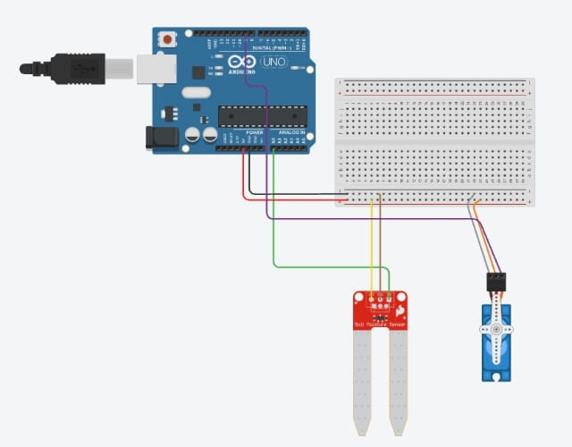
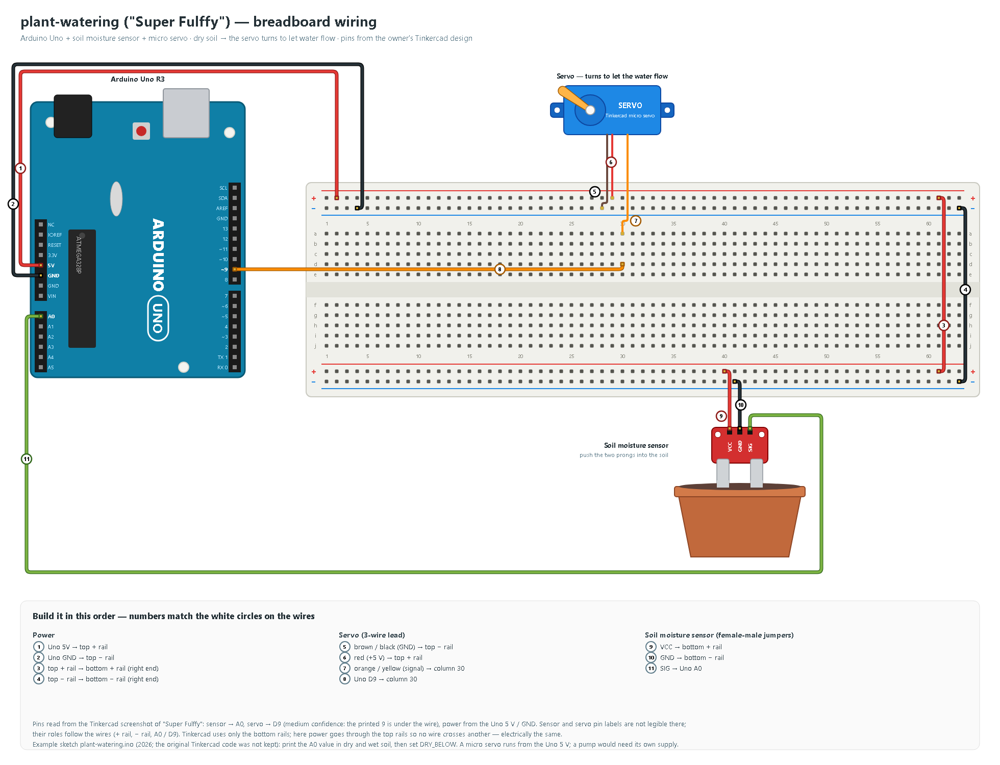

# arduino-plant-waterer ("Super Fulffy")

An Arduino Uno plant waterer designed in Tinkercad: a soil-moisture sensor in the pot and a micro servo. The
wiring diagram is numbered: each wire carries a white numbered circle, and the list under the drawing tells
you what to plug where, in that order.

A Tinkercad design: a soil-moisture sensor in the pot and a micro servo. When the soil is dry, the servo
turns to let water flow, then turns back. The pins below are read from the Tinkercad screenshot of the original
circuit (servo signal D9: medium confidence):



The original Tinkercad code was not kept. [`plant-watering.ino`](plant-watering/plant-watering.ino) is an
example sketch written in 2026 for this circuit. The water mechanism itself (a tipping bottle, a tube clamp …)
is not part of the design. The version presented in class appears to show two LCD screens; their wiring is not
visible, so they are not in this diagram.

### Wiring



| Uno pin | Goes to | Note |
|---|---|---|
| 5V | breadboard + rails | sensor + servo |
| GND | breadboard − rails | common ground |
| A0 | soil sensor SIG | analog reading 0–1023 |
| D9 | servo signal | Servo library |

Not readable in the Tinkercad screenshot, so taken from the wires instead: the printed "9" under the servo wire
(the wire covers it; it is the 9th hole of the 10-pin header) and the pin labels on the sensor and the servo
connector (their roles follow the wires: + rail, − rail, A0 / D9). Tinkercad runs everything from the bottom
rails; the diagram feeds the top rails first so that no wire crosses another. Electrically it is the same.

**Calibrate before use:** open the Serial Monitor (9600 baud), note the value with the prongs in dry soil and
in wet soil, and set `DRY_BELOW` in the sketch between the two.

### Parts (BOM)

| Qty | Part | Note |
|---|---|---|
| 1 | Arduino Uno R3 (or compatible) + USB cable | |
| 1 | Soil-moisture sensor (two-prong, VCC / GND / SIG) | |
| 1 | Micro servo (SG90 or similar) | 3-wire lead |
| 1 | Breadboard (830 points) + jumper wires (male-male and female-male) | |

## Flash a real Uno

**Arduino IDE:** open the `.ino` file (the folder name must match the sketch name, it already does) →
*Tools → Board → Arduino Uno* → choose the port → **Upload** → open the Serial Monitor at **9600 baud**.


**arduino-cli:**

```bash
arduino-cli core install arduino:avr
arduino-cli lib install Servo
arduino-cli compile -b arduino:avr:uno plant-watering
arduino-cli upload  -b arduino:avr:uno -p COM3 plant-watering   # use your port, e.g. /dev/ttyACM0
```

This project was designed in Tinkercad and has no Wokwi file.

## Diagrams

All wiring images are generated from code with a small drawing kit, [`tools/wiring_kit.py`](tools/wiring_kit.py)
(Uno R3, breadboard, parts, numbered wires, the build-order list). `docs/draw_wiring.py` places the parts
and wires; pin numbers are taken from the sketch.

```bash
python plant-watering/docs/draw_wiring.py    # -> wiring.svg
python tools/render_png.py                   # every docs/*.svg -> .png (headless Edge or Chrome)
python tools/check_pins.py                   # diagram pins vs. sketch pins + README links; exit 1 on a mismatch
```

Other small Arduino Uno builds by the same author:

- [arduino-proximity-alert](https://github.com/alpserkanmerkit/arduino-proximity-alert): HC-SR04 distance zones with three LEDs, ending in a propeller fan
- [arduino-servo-follow](https://github.com/alpserkanmerkit/arduino-servo-follow): a servo arm that follows your hand (sketch, not yet tested with a servo)

## License

[MIT](LICENSE) © 2026 Alp Serkan Merkit
